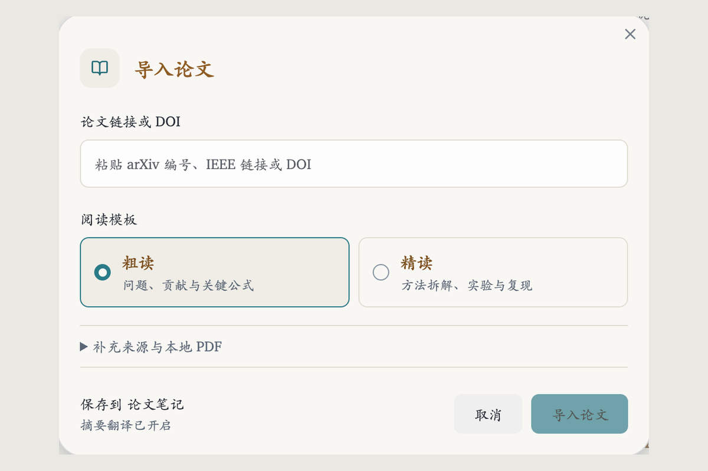

# Paper Bridge

Turn an arXiv link, an IEEE Xplore link, or a DOI into a reading note in Obsidian. The note opens with the paper's abstract and includes a reading outline you can fill in. When available, Paper Bridge also saves the PDF and the main figure alongside the note. Basic imports work without an API key.

[中文使用说明](https://github.com/BIT-Penry/Paper-Bridge/blob/main/README.zh-CN.md) · [Release notes](https://github.com/BIT-Penry/Paper-Bridge/releases/latest) · [Report an issue](https://github.com/BIT-Penry/Paper-Bridge/issues)



## Install

In Obsidian desktop **1.15.0 or later**, open **Settings → Community plugins → Browse**, search for **Paper Bridge**, then select **Install** and **Enable**.

For manual installation, download the [plugin ZIP](https://github.com/BIT-Penry/Paper-Bridge/releases/latest/download/paper-bridge.zip), unzip it, and place the entire `paper-bridge` folder in your vault's `.obsidian/plugins/` directory. Reopen Obsidian and enable Paper Bridge in Community plugins.

## Import your first paper

1. Click the download icon in the left ribbon or search for **Paper Bridge** in the command palette and choose the paper import command. The screenshot above shows the Chinese interface.
2. Paste a paper link or DOI, such as `10.1109/LRA.2025.3546069`. Choose **Quick Read** to record the research question, contributions, assumptions, evidence, limitations, key equations, and related notes. Choose **Deep Read** for a closer look at the method, training, deployment, and reproduction.
3. Open the new note. The translated abstract (if enabled), original abstract, and main figure appear above the reading outline. Add your own tags as you read.

Each paper gets a folder named by year and title. When available, the PDF is saved as `paper.pdf` and the main figure in `images/`. Importing a recognized DOI or arXiv ID again opens the existing note. Changing the reading depth property preserves what you have written.

## Use your own Markdown template

Create a regular note in your vault with the headings, tables, or checklists you want in each new paper note. For example:

```markdown
## Reproduction checklist

- [ ] Identify the figure or table to reproduce.
- [ ] Record the code and dataset versions.

## Differences from the published results
```

In **Settings → Paper Bridge**, find the custom reading templates under import settings, add the note, and optionally set it as the default. At import time, Paper Bridge inserts the latest template body after the abstracts and figure, skipping its YAML properties. Edits apply to future imports. If you move or rename the template file, register its new path.

## Translate abstracts into Chinese

Translation is optional and starts turned off. In the Paper Bridge settings, choose a provider or enter a custom OpenAI-compatible endpoint. Enter the base URL and API key, then fetch the model list or type a model name. Select the verify-and-enable button to test the connection with a sample sentence. You can also translate an existing paper's abstract from the command palette.

When translation is enabled, the selected provider receives the original abstract and may charge for the request. The key is stored in Obsidian's keychain on the current device. If translation fails, the reading note is still created.

## PDFs and figures

Paper Bridge checks the original source for an accessible PDF. It can also match an arXiv preprint by title and authors or look up an open copy through Semantic Scholar. The note records the PDF source and version. If you have a local copy, use the command palette to attach it.

To find the main figure, Paper Bridge looks for captions in the paper's HTML that describe the architecture, framework, or system overview. The note embeds the image and uses it as its cover. If the choice is ambiguous, run the main figure command on the open note and choose by caption. Papers available only as PDFs require a manually supplied figure. Supported image formats are PNG, JPEG, GIF, and WebP. The size limits are 20 MB per figure and 80 MB per PDF.

## Development

Use Node.js 18 or later. The build and offline tests use no third-party dependencies.

```sh
npm run build
npm run check
npm test
```

See the [desktop test notes](https://github.com/BIT-Penry/Paper-Bridge/blob/main/docs/manual-test-2026-11-11.md) and the [release checklist](https://github.com/BIT-Penry/Paper-Bridge/blob/main/docs/release-checklist.md).

Paper Bridge is licensed under the MIT License. Paper PDFs, figures, and abstracts belong to their respective rights holders. Provider icons are from [Lobe Icons](https://github.com/lobehub/lobe-icons) (MIT).
